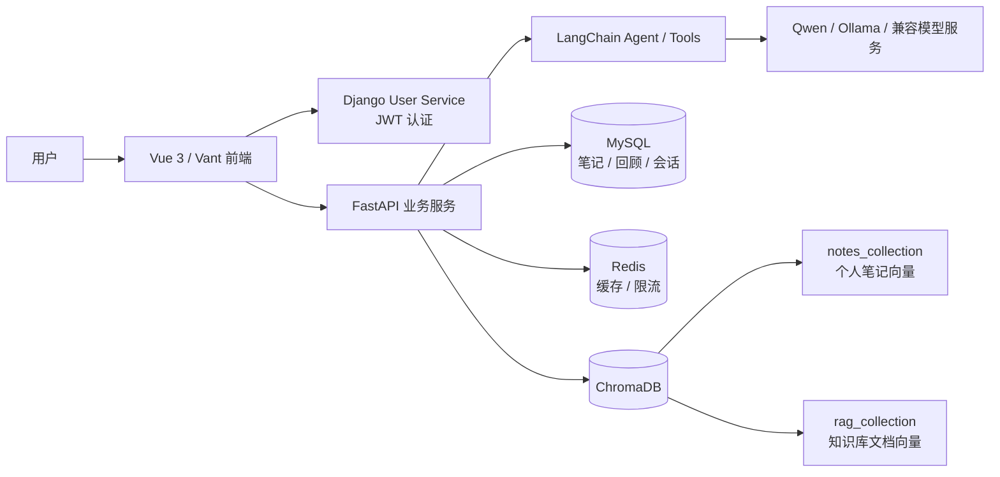
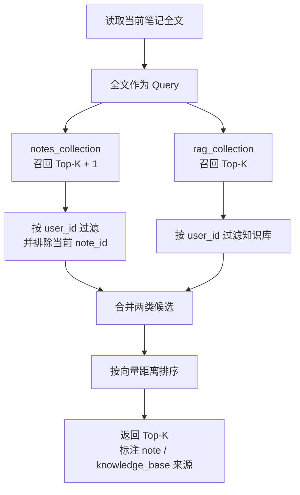
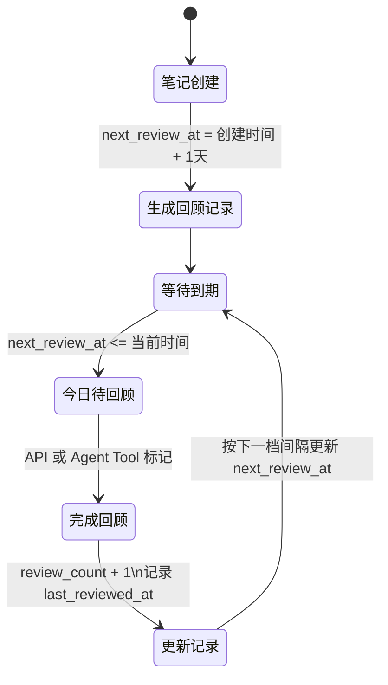

# RAG NoteBook — 智能笔记助手（Vue / Django 版）

<div align="center">
  
  
  
  
</div>

RAG NoteBook 是一个面向个人学习场景的智能笔记助手，将 **Markdown 笔记、课程资料知识库、RAG Agent 问答、跨源语义关联和间隔回顾** 统一到一套系统中，重点解决两个问题：

1. 笔记、课件和资料分散在不同位置，仅靠关键词难以发现它们之间的语义关联。
2. 笔记保存后缺少主动回顾机制，知识难以长期沉淀。

本仓库维护 Vue 3 + Django 用户服务版本，基于 [RMA-MUN/RAGNotebook](https://github.com/RMA-MUN/RAGNotebook) v2.0.0 继续开发。完整演进背景见[项目变迁说明](./docs/project_develop.md)，希望系统学习代码的同学可参考[四周项目学习路线](./docs/project_learning_roadmap.md)。

## 项目总览

系统以 FastAPI 作为核心业务服务，以 MySQL 保存结构化数据和会话历史，以 ChromaDB 保存笔记及知识库文档向量，并通过 LangChain Agent 将检索、笔记管理和回顾能力封装成可调用工具。

| 能力 | 主要实现 | 解决的问题 |
|---|---|---|
| 笔记管理 | Markdown 编辑、分页列表、分类、标签、导出 | 统一记录和维护个人笔记 |
| 智能标签 | 保存笔记后异步调用 LLM 生成标签和分类 | 降低手工整理成本 |
| 知识库 | TXT / PDF / MD / PPTX / DOCX 解析、切片、向量化 | 统一沉淀课程资料和文档 |
| 语义检索 | ChromaDB 向量召回、CrossEncoder 重排序 | 发现关键词不同但语义相关的内容 |
| 跨源关联推荐 | 同时检索笔记集合与知识库集合，合并 Top-K | 打通知识孤岛，辅助笔记复用 |
| RAG Agent 问答 | LangChain Agent、Tools、SSE 流式输出、引用来源 | 基于个人资料完成可追溯问答 |
| 间隔回顾 | 到期查询、回顾次数持久化、自动重排期 | 形成持续复习的学习闭环 |
| AI 写作 | 内联补全、续写、扩写、摘要 | 降低内容整理和写作成本 |
| 用户与会话 | Django JWT、用户级数据查询、MySQL 会话持久化 | 支持多用户使用和历史会话回溯 |

## 系统架构



核心数据链路：

```text
笔记/课程资料 → 清洗与切片 → Embedding → ChromaDB
                                      ↓
用户问题/当前笔记 → 跨 Collection 召回 → 合并排序 → Agent/前端展示

笔记创建 → 生成回顾记录 → 到期筛选 → 完成回顾 → 自动计算下次时间
```

## 核心设计一：跨源知识关联推荐

传统关键词检索要求用户记得资料中的准确措辞，而课程资料、个人笔记和知识库文档往往使用不同表述。本项目使用统一向量空间，将不同来源的内容转换为可比较的语义表示，实现“笔记—笔记—知识库”之间的隐式关联。

### 存储与索引设计

- MySQL 保存笔记标题、Markdown 原文、标签、分类、用户 ID 和时间等结构化数据。
- ChromaDB 的 `notes_collection` 保存个人笔记全文向量。
- ChromaDB 的 `rag_collection` 保存上传文档切片向量。
- 两个 Collection 复用同一个 `embed_model`，保证向量可在同一语义空间中比较。
- 笔记更新或删除时同步更新对应向量，MySQL 继续作为完整笔记数据的事实来源。

### 关联推荐流程



系统使用当前笔记全文而不是少量关键词作为 Query：先从 `notes_collection` 召回当前用户语义相近的其他笔记并排除当前笔记，再从 `rag_collection` 召回当前用户的相关知识库切片，最后合并候选并按向量距离排序（距离越小表示越相关）。这样，即使不同资料没有共享明显关键词，也能够被关联发现与复用。

主要代码入口：

- [`NoteService.create_note`](./backend/app/services/note_service.py)：MySQL 与 ChromaDB 笔记向量双写。
- [`NoteService.search_notes`](./backend/app/services/note_service.py)：笔记语义检索与 MySQL 完整数据回填。
- [`NoteService.get_related_notes`](./backend/app/services/note_service.py)：跨 Collection 召回、当前笔记过滤及 Top-K 合并排序。
- [`VectorStoreService`](./backend/app/rag/vector_store.py)：知识库向量存储与检索。
- [`get_related_notes_tool`](./backend/app/agent/agent_tools.py)：将关联推荐暴露给 Agent。

对应接口：

```http
GET /note/search?q={query}&top_k=10
GET /note/{note_id}/related?top_k=3
```

## 核心设计二：间隔回顾闭环

项目参考艾宾浩斯遗忘规律，采用 `1 / 2 / 4 / 7 / 15 / 30` 天递增间隔管理笔记回顾。系统不只展示“今日任务”，还将回顾状态持久化，并把查询与完成动作接入 Agent Tools，使用户可以在对话中查看和完成回顾。

### 回顾记录模型

每篇进入回顾流程的笔记都有独立的 `ReviewRecord`：

| 字段 | 作用 |
|---|---|
| `note_id` / `user_id` | 关联笔记并隔离用户数据 |
| `review_count` | 已完成回顾次数 |
| `last_reviewed_at` | 上一次实际回顾时间 |
| `next_review_at` | 下一次应回顾时间 |
| `interval_days` | 当前采用的间隔天数 |

### 回顾调度流程



完成一次回顾后，服务会递增 `review_count`，记录 `last_reviewed_at`，按照下一档间隔计算新的 `next_review_at`，形成“知识沉淀—到期回顾—完成反馈—自动重排期”的周期复习闭环。超过预设序列后固定采用 30 天间隔。

主要代码入口：

- [`ReviewRecord`](./backend/app/models/review_record.py)：回顾状态持久化模型。
- [`ReviewService.get_today_reviews`](./backend/app/services/review_service.py)：按用户和到期时间筛选待回顾笔记。
- [`ReviewService.mark_reviewed`](./backend/app/services/review_service.py)：完成标记与自动重排期。
- [`get_today_reviews_tool`](./backend/app/agent/agent_tools.py)：Agent 查询今日待回顾笔记。
- [`mark_reviewed_tool`](./backend/app/agent/agent_tools.py)：Agent 完成回顾并触发下次调度。

对应接口：

```http
GET  /review/today
POST /review/done/{note_id}
```

## 其他核心能力

- **Markdown 笔记管理**：支持新建、编辑、删除、分类筛选、标签和分页列表。
- **智能标签**：保存笔记后，后台调用 LLM 生成标签和工作/学习/生活/项目分类。
- **RAG 知识库**：支持 TXT、PDF、MD、PPTX、DOCX 上传和可视化切片详情。
- **Agent 智能问答**：通过工具调用搜索笔记、查询统计、创建笔记、获取关联推荐和管理回顾。
- **AI 写作辅助**：提供内联补全、续写、扩写和摘要，支持 SSE 流式输出。
- **会话持久化**：使用 MySQL 保存用户会话和消息历史。
- **多语言与主题**：Vue i18n 中英文界面及亮色/暗色主题切换。

## 当前实现边界

- 间隔回顾采用固定递增序列，不是根据记忆难度动态计算的 SM-2 或 FSRS 算法。
- 笔记向量双写和后台标签任务目前采用进程内异步机制，生产部署可进一步升级为持久化任务队列与失败补偿。
- 跨源关联当前使用向量距离合并排序；独立 CrossEncoder 重排序主要用于 RAG 问答链路。

## 项目演示

| 功能模块 | 界面展示 | 功能说明 |
|---------|:--------|---------|
| 📒编辑 |  | 在线markdown编辑器，支持行内AI补全、相关笔记推荐 |
| 📝 笔记 |  | 笔记列表，自动分类、打标签 |
| 🔄 每日回顾 |  | 艾宾浩斯遗忘曲线算法 ，每日提醒需要回顾的内容 |
| 💬 AI 聊天 |  | RAG 智能问答，支持上下文对话和文档引用 |
| 📚 知识库 |  | 多格式文档上传和管理 |
| ✂️ 文档切片 |  | 可视化文档切片详情 |

## 快速开始

### 环境要求

| 环境 | 版本推荐 |
|------|----------|
| Python | 3.12+ |
| uv | 0.11.9 |
| Node.js | 16+ |

### 克隆项目

```bash
git clone git@github.com:jinjiecainiao/rag-notebook.git
cd rag-notebook
```

### 安装依赖

#### 后端依赖
```bash
cd backend
uv sync
```

#### 前端依赖
```bash
cd front
npm install
# 或使用 pnpm
pnpm install
```

### 环境配置

#### 创建后端环境变量文件

在 `backend` 目录下创建 `.env` 文件，参考 `.env.example` 文件填写配置：

```env
# ==================== LLM 大模型配置 ====================
# LLM类型：ALIYUN | OLLAMA | DEEPSEEK
LLM_TYPE=ALIYUN

# ==================== Ollama 配置 (LLM_TYPE=OLLAMA) ====================
OLLAMA_BASE_URL=http://localhost:11434
OLLAMA_MODEL_NAME=qwen3.5:0.8b

# ==================== 阿里云百炼配置 (LLM_TYPE=ALIYUN) ====================
ALIYUN_ACCESS_KEY_SECRET=your_api_key
ALIYUN_BASE_URL=https://dashscope.aliyuncs.com/compatible-mode/v1
CHAT_MODEL_NAME=qwen3-max

# ==================== DeepSeek 配置 (LLM_TYPE=DEEPSEEK) ====================
DEEPSEEK_API_KEY=your_deepseek_api_key
DEEPSEEK_BASE_URL=https://api.deepseek.com
DEEPSEEK_MODEL_NAME=deepseek-v4-flash

# ==================== 向量嵌入模型配置 ====================
EMBED_MODEL_TYPE=OLLAMA
TEXT_EMBEDDING_MODEL_NAME=qwen3-embedding:0.6b
ALIYUN_EMBED_MODEL_NAME=qwen3-embedding

# ==================== 数据库配置 ====================
MYSQL_USER=root
MYSQL_PASSWORD=root
MYSQL_HOST=localhost
MYSQL_PORT=3306
MYSQL_DATABASE=chat_history

REDIS_HOST=localhost
REDIS_PORT=6379
REDIS_DB=0

# ==================== 服务配置 ====================
DJANGO_API_URL=http://127.0.0.1:8001

# ==================== LangSmith 调试追踪 ====================
LANGCHAIN_TRACING_V2=true
LANGCHAIN_API_KEY=your_langsmith_api_key
LANGCHAIN_PROJECT=my-fastapi-langchain-project

# ==================== 重排序模型配置 ====================
RERANKER_MODEL_PATH=D:\Hugging_Face\models\Qwen3-Reranker-0.6B

# ==================== JWT 身份验证配置 ====================
SECRET_KEY=MY_JWT_SECRET_KEY
ALGORITHM=HS256
```

#### 创建用户服务环境变量文件

在 `DjangoUserService` 目录下创建 `.env` 文件：

```env
# JWT 配置
JWT_SECRET_KEY=YOUR_JWT_SECRET_KEY

# 数据库配置
DB_PORT=3306
DB_NAME=user_service
DB_USER=root
DB_PASSWORD=root
DB_HOST=localhost

# Celery 配置
CELERY_BROKER_URL=redis://localhost:6379/0
CELERY_RESULT_BACKEND=redis://localhost:6379/0
CELERY_TASK_TIME_LIMIT=300
CELERY_TASK_SOFT_TIME_LIMIT=250
CELERY_RESULT_EXPIRES=3600

# Redis 配置
REDIS_CACHE_URL=redis://localhost:6379/1
```

配置好 env 文件后，执行 Django ORM 迁移：

```bash
python manage.py makemigrations
python manage.py migrate
```

### 向量数据库配置

修改 `backend/app/config/chroma.yaml` 文件：

```yaml
collection_name: rag_collection
persist_directory: data/chromadb
k: 3

data_path: data
md5_hex_store: data/md5_hex_store/md5_hex_store.txt
allow_knowledge_file_types: ["txt", "pdf", "md", "pptx", "docx"]

chunk_size: 200
chunk_overlap: 20
separators: ["\n\n", "\n", "。", "！", "？", "!", "?", " ", ""]
```

### 启动服务

| 服务 | 命令 | 端口 |
|------|------|------|
| 后端服务 | `cd backend && uvicorn main:app --reload` | 8000 |
| 前端服务 | `cd front && npm run dev` | 3000 |
| 用户服务 | `cd DjangoUserService && uv run python manage.py runserver 8001` | 8001 |
| MySQL | `net start mysql` | 3306 |
| Redis | `redis-server` 或 `net start redis` | 6379 |
| Ollama | `ollama serve` | 11434 |

## 技术栈

### 后端技术

| 技术 | 说明 |
|------|------|
| FastAPI | 高性能异步 Web 框架 |
| LangChain | 大语言模型应用开发框架（AgentExecutor + Tools） |
| ChromaDB | 轻量级向量数据库（rag_collection + notes_collection） |
| SQLAlchemy | 异步 ORM，管理 MySQL |
| Django | 用户认证和管理系统 |
| MySQL | 关系型数据库（chat_history / notes / reviews） |
| Redis | 缓存 |
| DashScope API | 大语言模型服务（Qwen3-Max） |
| Ollama | 本地模型部署（qwen3.5:0.8b 联机补全） |
| Hugging Face | 重排序模型（Qwen3-Reranker-0.6B） |
| Sentence-Transformers | 句子嵌入模型 |

### 前端技术

| 技术 | 说明 |
|------|------|
| Vue 3 | 现代化前端框架（Composition API） |
| Vite | 极速构建工具 |
| Vant 4 | 移动端 UI 组件库 |
| bytemd | Markdown 编辑器（Web Component） |
| Vue Router | 路由管理（路由守卫 + JWT 校验） |
| Pinia | 状态管理 |
| Vue i18n | 国际化（中/英） |
| Axios | HTTP 客户端 |
| highlight.js | 代码语法高亮 |
| dompurify | HTML 安全过滤 |

## 项目结构

```
├── backend/                     # FastAPI 后端服务
│   ├── app/
│   │   ├── agent/               # Agent 智能代理模块
│   │   │   └── agent.py         # AgentFactory + Tool 定义
│   │   ├── config/              # 配置文件（chroma.yaml 等）
│   │   ├── core/                # 核心工具（限流、响应封装、日志）
│   │   ├── db/                  # 数据库配置（MySQL + Redis）
│   │   ├── model/               # SQLAlchemy ORM 模型
│   │   │   ├── note.py          # 笔记模型
│   │   │   ├── review_record.py # 回顾记录模型
│   │   │   └── chat_history.py  # 对话历史模型
│   │   ├── prompt/              # 提示词模板（8个）
│   │   ├── rag/                 # RAG 核心功能
│   │   │   ├── rag_service.py   # RAG 服务（HyDE + 混合检索）
│   │   │   ├── reorder_service.py
│   │   │   ├── vector_store.py  # ChromaDB 封装
│   │   │   ├── text_spliter.py  # 文档切片
│   │   │   ├── document_handler/# 文档解析（txt/pdf/md/pptx/docx）
│   │   │   ├── retrievers/      # 自定义检索器
│   │   │   └── task_queue.py    # 后台处理队列
│   │   ├── router/              # API 路由
│   │   │   ├── chat.py          # 聊天 & Agent 路由
│   │   │   ├── note_router.py   # 笔记 CRUD & AI 路由
│   │   │   ├── review_router.py # 间隔重复回顾路由
│   │   │   ├── knowledge_router.py
│   │   │   ├── user.py
│   │   │   └── health.py
│   │   ├── schemas/             # Pydantic 数据模型
│   │   ├── services/            # 业务服务层
│   │   │   ├── note_service.py  # 笔记服务（CRUD + 向量化 + AI 写作）
│   │   │   └── review_service.py# 回顾服务（艾宾浩斯算法）
│   │   └── utils/               # 工具函数
│   ├── data/                    # 数据存储目录
│   ├── main.py                  # 应用入口
│   └── pyproject.toml
├── front/                       # Vue 3 前端项目
│   ├── src/
│   │   ├── components/          # 通用组件
│   │   │   ├── MarkdownEditor.vue   # bytemd 封装
│   │   │   ├── RelatedNotes.vue     # 关联笔记侧边栏
│   │   │   ├── InlineCompletion.vue # AI 联机补全
│   │   │   ├── ReviewCard.vue       # 回顾卡片
│   │   │   ├── TagBadge.vue         # 标签徽章
│   │   │   ├── TabBar.vue           # 底部导航
│   │   │   └── QuickToolbar.vue     # 快捷工具栏
│   │   ├── views/              # 页面视图
│   │   │   ├── NoteEditor.vue       # 笔记编辑器
│   │   │   ├── NoteList.vue         # 笔记列表
│   │   │   ├── DailyReview.vue      # 每日回顾
│   │   │   ├── AIChat.vue           # AI 聊天
│   │   │   ├── Sessions.vue         # 会话管理
│   │   │   ├── KnowledgeBase.vue    # 知识库管理
│   │   │   ├── Login.vue / Register.vue
│   │   │   ├── My.vue / Profile.vue / Settings.vue
│   │   │   └── AboutUs.vue
│   │   ├── router/index.js     # 路由配置
│   │   ├── store/              # Pinia 状态管理
│   │   ├── i18n/               # 国际化（中/英）
│   │   └── config/api.js       # API 地址配置
│   └── package.json
├── DjangoUserService/           # Django 用户服务
│   ├── apps/
│   │   ├── user/               # 用户注册/登录/认证
│   │   ├── file/               # 头像上传
│   │   └── utils/              # 工具函数
│   └── api.md                  # 用户服务 API 文档
├── docs/                        # 项目文档
│   ├── modelscope_model.md     # 模型下载和配置
│   └── troubleshooting.md      # 故障排除
├── images/                      # 截图资源
└── plan.md                     # 项目规划
```

## API 文档

### FastAPI 后端 API

完整的 OpenAPI 规范文件：[backend/openapi.json](./backend/openapi.json)
		启动服务后访问交互式文档：[http://localhost:8000/docs](http://localhost:8000/docs)

### Django 用户服务 API

详细文档：[DjangoUserService/api.md](./DjangoUserService/api.md)
		交互式文档（启动后）：[http://localhost:8001/docs/](http://localhost:8001/docs/)

## 配置说明

### LLM 模型切换

系统支持 **阿里云百炼（DashScope）**、**Ollama（本地部署）** 和 **DeepSeek** 三种模式：

- **LLM_TYPE=ALIYUN**：使用 Qwen3-Max 大模型 + text-embedding-v4 嵌入
- **LLM_TYPE=OLLAMA**：使用本地 Ollama 模型
- **LLM_TYPE=DEEPSEEK**：使用 DeepSeek API；向量嵌入仍由 `EMBED_MODEL_TYPE` 单独配置

### 重排序模型

下载 Qwen3-Reranker-0.6B 模型并配置 `RERANKER_MODEL_PATH` 路径，参考 [模型配置指南](./docs/modelscope_model.md)。

## 故障排除

详细的故障排除指南请参考：[故障排除](./docs/troubleshooting.md)

常见问题：

- **API Key 错误**：检查 `ALIYUN_ACCESS_KEY_SECRET` 或 `DEEPSEEK_API_KEY` 是否正确配置
- **数据库连接失败**：确认 MySQL / Redis 服务已启动
- **ChromaDB 异常**：检查 `chroma.yaml` 中的路径配置
- **重排序模型加载失败**：确认 `RERANKER_MODEL_PATH` 指向正确的模型路径
- **Ollama 连接失败**：确认 `ollama serve` 已运行且模型已拉取

## 开源与致谢

本项目基于 [RMA-MUN/RAGNotebook](https://github.com/RMA-MUN/RAGNotebook) `v2.0.0` 继续开发。上游项目采用 MIT License；公开发布衍生版本时，应保留相应的版权与许可文本。问题、建议和改进方案欢迎通过本仓库 Issues 提交。
